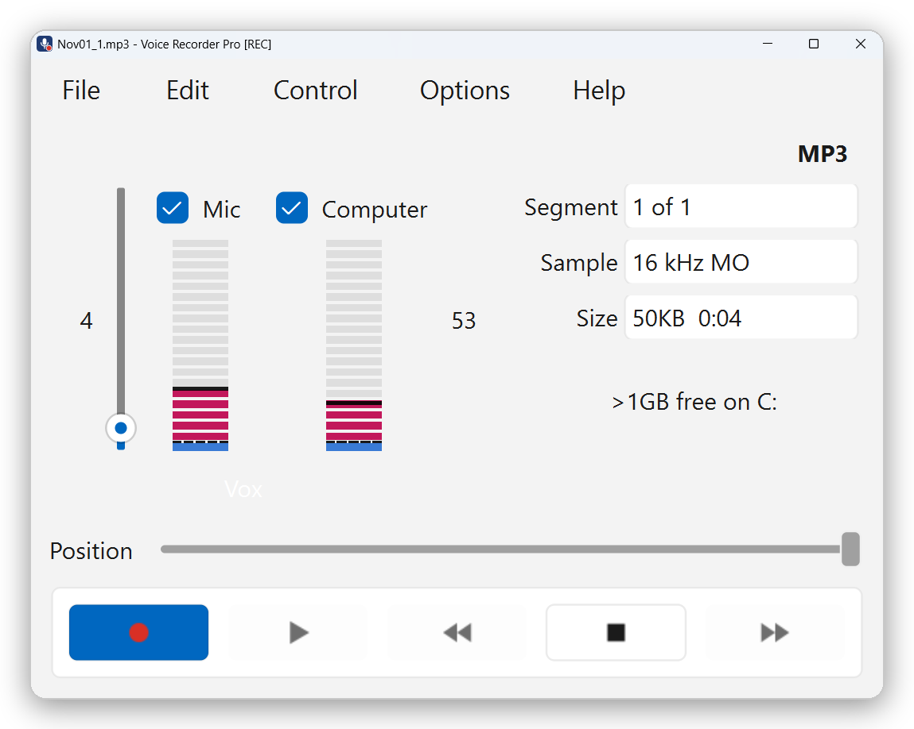
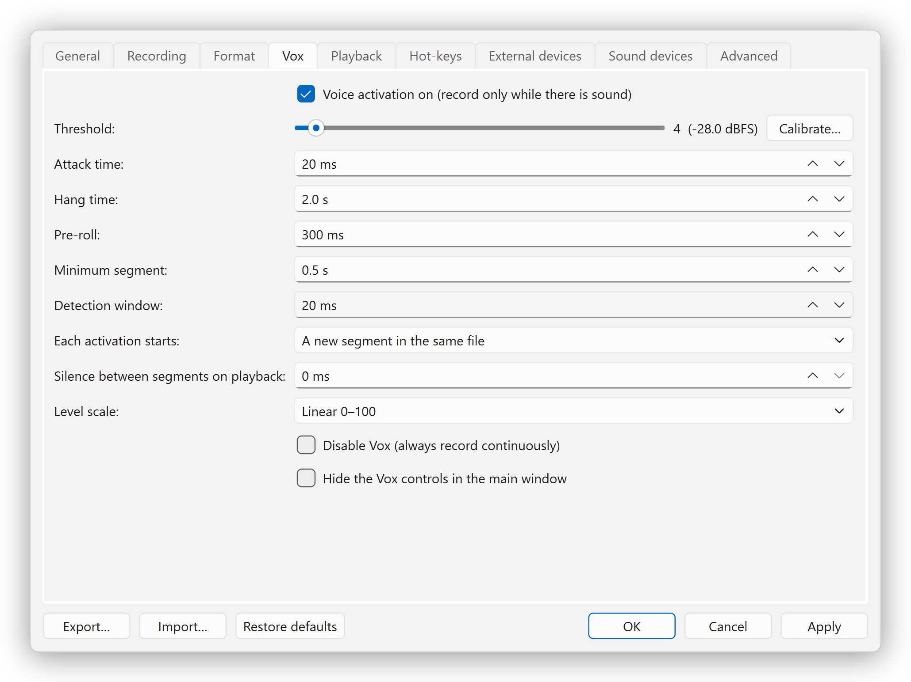

# Voice Recorder Pro

**Record every meeting. Skip every silence. Install nothing.**

<p>
  <a href="https://github.com/hylhk23/VoiceRecorderPro/releases/latest"></a>
  
  
  <a href="https://buymeacoffee.com/flyingturtle"></a>
</p>

A voice-activated recorder for Windows 11 that captures your microphone **and** your computer's sound together, so you can record Zoom and Microsoft Teams meetings for minutes. Portable: unzip and run, no installation and no admin rights.

**[Download the latest version](https://github.com/hylhk23/VoiceRecorderPro/releases/latest)** · Windows 11, 64-bit · Free

<p align="center">
  
</p>

## What it does

Voice Recorder Pro sits quietly in the system tray and records the conversations that matter: online meetings, calls on your PC, interviews and dictation. Tick **Mic** to capture your voice, tick **Computer** to capture the other participants, and press Record. Voice activation keeps the parts where someone is speaking and skips long silences, marks each one with a time stamp, and saves a compact MP3 that is ready for your transcription software. Everything stays on your PC.

| | |
| --- | --- |
| **Mic + computer audio in one file** | Both sides of a Zoom, Teams or Webex call, mixed into a single recording |
| **Voice-activated** | Records only when sound is above your threshold, so long silences are not recorded |
| **Portable** | Unzip and run `run.bat`. No installer, no admin rights |
| **Small, transcription-ready files** | MP3 at 16 kHz mono, about 14 MB per hour |
| **Time-stamped segments** | Jump straight to any part of the discussion |
| **Private** | No account, no cloud, no internet connection |

> **Free, with no ads, no account and no subscription.** If Voice Recorder Pro saves you an hour of note-taking, consider buying me a coffee. It keeps the project going.
>
> <a href="https://buymeacoffee.com/flyingturtle"></a>

---

## Why it suits the office

### Records both sides of a Zoom or Teams meeting
Voice Recorder Pro records the **microphone** (your voice) and **computer audio** (everything played through your speakers or headset: the other participants in Zoom, Teams, Webex or a phone app) into one file. Each source has its own level meter and tick box, and you can switch either on or off at any time, even mid-recording. The result is a single recording of the whole conversation, ready for writing minutes.

### Records only when someone is speaking
Voice activation (Vox) starts recording when sound rises above a threshold you set and pauses when the room goes quiet (after a short hang time, 2 seconds by default, so pauses between sentences are kept). Long silences never reach the file, so:
- you don't waste time playing back or scrolling through dead air;
- speech-to-text (STT) transcription software has less audio to process, so transcripts come back faster;
- files stay small. The default format (MP3, 16 kHz mono, 32 kbit/s) uses about 14 MB per hour of recorded audio, and 16 kHz mono is plenty for speech.

Each burst of speech is marked as a segment with a time stamp, so you can jump straight to any point of the discussion.

You control how sensitive it is: the threshold, how quickly recording starts (attack), how long it keeps going after you stop talking (hang time), and a short pre-roll so the first word is never cut off. **Calibrate** measures your room and suggests a threshold.

<p align="center">
  
</p>

### No installation, no admin rights
It is a portable application. Copy the folder to any location you can write to (your Documents, a D: drive, a USB stick) and double-click `run.bat`. Nothing is installed and **no administrator rights are needed**, so it works on a managed work PC where you cannot install software. To remove it, delete the folder.

### Unlikely to trigger antivirus false alarms
Python programs packed into an `.exe` with tools such as PyInstaller are sometimes flagged by antivirus engines. Voice Recorder Pro avoids that packing:
- the package contains only **two `.exe` files**: `python.exe` and `pythonw.exe`, the official Python 3.13 interpreter from python.org, **digitally signed by the Python Software Foundation**;
- everything else is plain Python source code (`.py`), which you can read, and standard library files (`.pyd`, `.dll`) from python.org and the Python Package Index;
- it makes no internet connections. Recordings and settings stay on your PC.

### Other useful features
- Hot-keys that work from any app (default: `Ctrl+Alt+R` record/pause, `Ctrl+Alt+S` stop).
- Runs in the system tray; the taskbar button shows a red dot while recording.
- Crash-safe: audio is written to disk every second, and an interrupted recording is recovered on the next start.
- Timed and scheduled recordings, playback at 50 to 200 % speed with normal pitch, and simple editing (cut, split, join, extract a section).
- Formats: MP3, WAV and FLAC.

> Record meetings only with the participants' knowledge and in line with your organization's policies and local law.

---

## Install

You need Windows 11 (64-bit). The download is a zip file of about 49 MB (125 MB once extracted).

### Option 1: manual download

1. Open the **[latest release](https://github.com/hylhk23/VoiceRecorderPro/releases/latest)** and click **`VoiceRecorderPro-portable-win64.zip`** under *Assets*.
2. In File Explorer, right-click the downloaded zip, choose **Properties**, tick **Unblock** at the bottom (if shown) and click **OK**. This stops Windows from showing security warnings for files that came from the internet.
3. Right-click the zip and choose **Extract All...**, pick a folder you can write to (for example `C:\Users\<you>\Apps`) and click **Extract**. Inside it you get a folder named `VoiceRecorderPro`. (Windows may add a folder named after the zip around it; that is fine.)
4. Open the `VoiceRecorderPro` folder and double-click **`run.bat`**.
5. Optional: double-click **`create-shortcut.bat`** to add Voice Recorder Pro to your Desktop and Start menu. Run it again if you move the folder.

### Option 2: command line

Open **Command Prompt** or **PowerShell** and run these lines. They use `curl` and `tar`, which are built into Windows 11, and save the program to `C:\Users\<you>\VoiceRecorderPro`.

```bat
cd %USERPROFILE%
curl.exe -L -o VoiceRecorderPro-portable-win64.zip https://github.com/hylhk23/VoiceRecorderPro/releases/latest/download/VoiceRecorderPro-portable-win64.zip
tar -xf VoiceRecorderPro-portable-win64.zip
VoiceRecorderPro\run.bat
```

In PowerShell, replace the first line with `cd $env:USERPROFILE` and the last line with `.\VoiceRecorderPro\run.bat`.

To add the Desktop and Start-menu shortcuts from the command line: `VoiceRecorderPro\create-shortcut.bat`

**Check the download (optional).** Compare the SHA-256 value with the one listed on the release page:

```bat
certutil -hashfile VoiceRecorderPro-portable-win64.zip SHA256
```

### Update to a new version
Download the new zip in the same way, close Voice Recorder Pro (right-click the tray icon, **Exit**), and replace the `VoiceRecorderPro` folder with the new one. Your recordings and settings are stored outside the program folder and are kept.

### Remove
Close the app, run `create-shortcut.bat /remove` if you created shortcuts, then delete the `VoiceRecorderPro` folder. Settings are in `%APPDATA%\VoiceRecorderPro` and logs in `%LOCALAPPDATA%\VoiceRecorderPro`; delete those too if you want to remove everything.

---

## Record a Zoom or Teams meeting

1. Start Voice Recorder Pro.
2. Tick both **Mic** and **Computer** above the level meters. (Computer audio is off by default.)
3. Check the Vox threshold: talk normally and watch the meter cross the dashed line. **Options > Vox > Calibrate** measures your room for you.
4. Press **Record** (red button, or `Ctrl+Alt+R` from any app), then join the meeting.
5. Press **Stop** (`Ctrl+Alt+S`) when the meeting ends.

Recordings are saved to **`Documents\VRP Recordings`** (change this in **Options > Recording**). Open the MP3 in your transcription software to produce the text for your minutes.

Tip: computer audio is taken from the Windows default output device. If the Computer meter stays empty, check **Settings > System > Sound > Output** is the headset or speakers that Zoom or Teams is using.

Full help: press **F1** in the app, or open [`docs/HELP.html`](docs/HELP.html).

---

## Troubleshooting

| Problem | What to do |
| --- | --- |
| "Windows protected your PC" or a security warning when running `run.bat` | This is Microsoft Defender SmartScreen, the Windows check on files downloaded from the internet. Unblock the zip (Option 1, step 2) and extract it again. |
| `run.bat` asks you to install Python, or nothing happens | Make sure the `python` folder is inside `VoiceRecorderPro`. Download the **portable** zip from Releases, not *Code > Download ZIP* (that is the source code only, without Python). |
| Your organization blocks programs in your user folders | Some IT policies only allow programs in approved locations. Ask your IT team. |
| Microphone meter stays empty | Windows **Settings > Privacy & security > Microphone**: allow desktop apps to use the microphone. |
| Computer meter stays empty | Make sure sound is playing on the Windows default output device (see the tip above). |

---

## For developers

The repository holds the Python source code. The portable zip on the Releases page adds the Python runtime and libraries in a `python` folder.

```bat
git clone https://github.com/hylhk23/VoiceRecorderPro.git
cd VoiceRecorderPro
run.bat
```

Without the `python` folder, `run.bat` needs Python 3.12 or 3.13 (64-bit) from python.org and downloads the libraries into a private `.venv` on first run. Tests, project layout and build notes: [`docs/DEVELOPER.md`](docs/DEVELOPER.md).

---

## Support the project

Voice Recorder Pro is built and maintained by one developer in spare time, and it will stay free: no ads, no account, no data collection. If it saves you time on meeting minutes, a coffee is a simple way to say thanks and helps pay for the time that goes into new features and fixes.

<p align="center">
  <a href="https://buymeacoffee.com/flyingturtle"></a>
  <br>
  <a href="https://buymeacoffee.com/flyingturtle">buymeacoffee.com/flyingturtle</a>
</p>

**Other ways to help, at no cost:**
- Click **Star** at the top of this page, so other people can find the app.
- Share it with colleagues who write meeting minutes.
- Report a problem or suggest a feature under **Issues**.

## Licence

Copyright © 2026 Neo Time Consulting. Free to download and use; see [LICENSE](LICENSE). Bundled third-party libraries keep their own licences; see [THIRD-PARTY-LICENSES.txt](THIRD-PARTY-LICENSES.txt).
