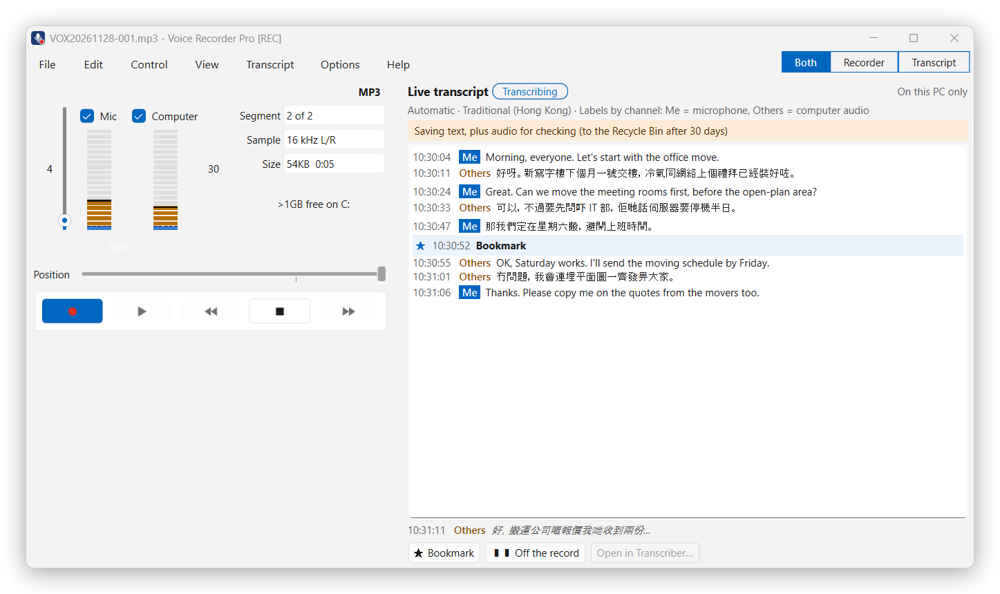
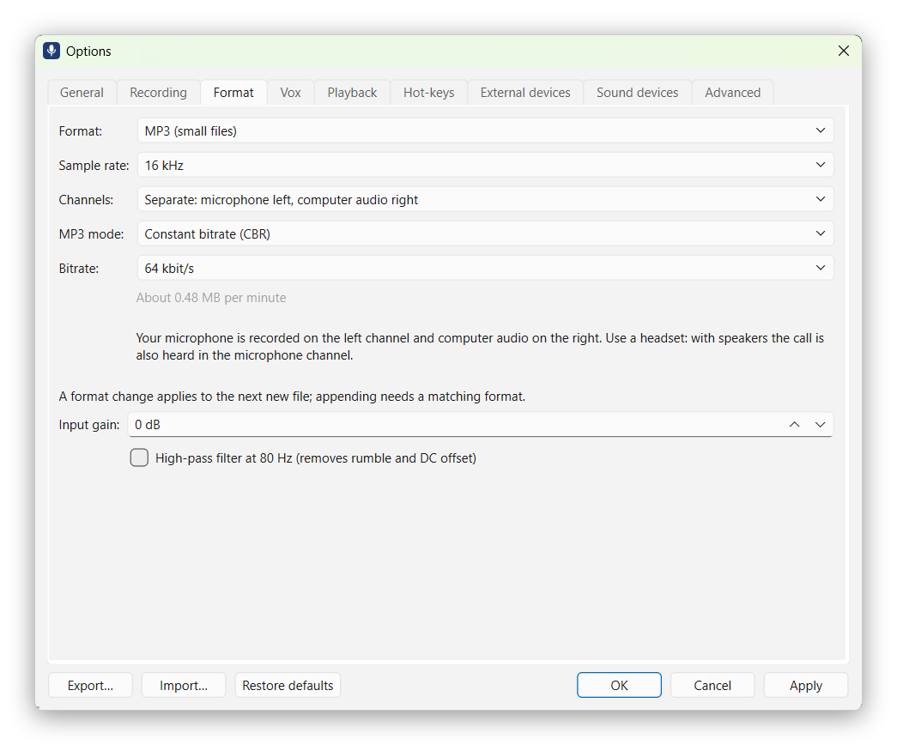
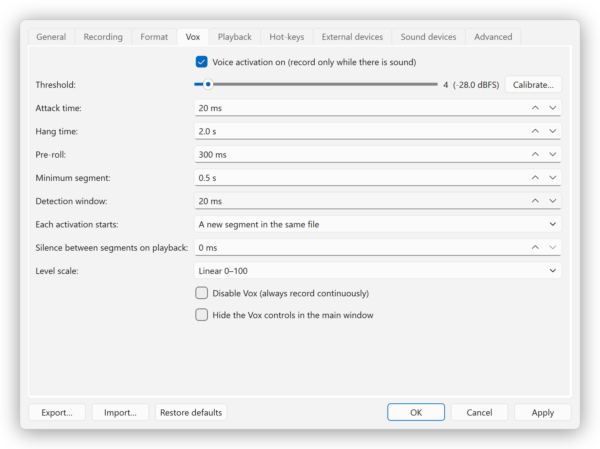

# Voice Recorder Pro

**Record every meeting. Skip every silence. Install nothing.**

<p>
  <a href="https://github.com/hylhk23/VoiceRecorderPro/releases/latest"></a>
  
  <a href="#licence-free-for-personal-use-licence-for-work"></a>
  <a href="#licence-free-for-personal-use-licence-for-work"></a>
  <a href="https://buymeacoffee.com/flyingturtle"></a>
</p>

A voice-activated recorder for Windows 11 that captures your microphone **and** your computer's sound, so you can record Zoom and Microsoft Teams meetings for minutes. Keep both sides mixed in one track, or on separate left and right channels so transcription software can tell your voice from the other participants. New in 1.1.0: a **live transcript** in English, Cantonese and Mandarin, recognised on your PC, with the choice to keep the audio, keep it only until you have checked the text, or save the text alone. Portable: unzip and run, no installation and no admin rights.

**Free for personal use. Use at work needs a commercial licence** ([details](#licence-free-for-personal-use-licence-for-work)).

**[Download the latest version](https://github.com/hylhk23/VoiceRecorderPro/releases/latest)** · Windows 11, 64-bit

<p align="center">
  
</p>

## What it does

Voice Recorder Pro sits quietly in the system tray and records the conversations that matter: online meetings, calls on your PC, interviews and dictation. Tick **Mic** to capture your voice, tick **Computer** to capture the other participants, and press Record. Voice activation keeps the parts where someone is speaking and skips long silences, marks each one with a time stamp, and saves a compact MP3 that is ready for your transcription software. Everything stays on your PC.

| | |
| --- | --- |
| **Mic + computer audio in one file** | Both sides of a Zoom, Teams or Webex call, mixed into a single recording |
| **Or on separate channels** | Your voice on the left, the other participants on the right, so transcription software can tell the two sides apart |
| **Live transcript (new in 1.1.0)** | English, Cantonese and Mandarin, also mixed, shown as people speak and saved as text and subtitles. Recognised on your PC with the optional Live Transcript pack: no internet, no graphics card |
| **Clearer voice in a noisy room** | Optional noise suppression and automatic level, with an untouched copy kept beside the cleaned file (new in 1.0.4) |
| **Voice-activated** | Records only when sound is above your threshold, so long silences are not recorded |
| **Portable** | Unzip and run `run.bat`. No installer, no admin rights |
| **Small, transcription-ready files** | MP3 at 16 kHz mono, about 14 MB per hour |
| **Time-stamped segments** | Jump straight to any part of the discussion |
| **Private** | No account, no cloud, no internet connection |

> **Free for personal use, with no ads, no account and no subscription.** If Voice Recorder Pro saves you an hour of note-taking at home, consider buying me a coffee.
>
> **Using it at work?** Use by or for a business or other organization needs a commercial licence, one per person. Buy it at [software.4u.hk](https://software.4u.hk) and you receive a licence file to put in the program folder. See [Licence](#licence-free-for-personal-use-licence-for-work).
>
> <a href="https://buymeacoffee.com/flyingturtle"></a>

---

## What's new in 1.1.0

**Live transcript.** See the words as they are spoken, in English, Cantonese and Mandarin, also mixed in one sentence, and save them beside the recording. Speech is recognised on your PC by the optional **Live Transcript pack** (a separate download, see [Install](#add-the-live-transcript-pack-optional)); nothing is sent over the internet and no graphics card is needed. Turn it on with **Transcript > Live Transcript On**.

- **Choose what to save** (Options > Transcript): audio and text; text, with the audio kept for checking and deleted after a number of days (7 by default) or as soon as you choose **Transcript > Mark Checked and Delete Audio**; or **text only**, with no sound saved at all.
- The transcript is saved as you go: a `.txt` with the time of each phrase, and `.srt` subtitles timed to the audio file. A power cut loses at most the last phrase.
- **Me and Others.** With **Format > Channels > Separate**, your microphone is labelled *Me* and the computer audio *Others*, so you can see who said what in a Teams or Zoom call.
- **Show both panels, or one.** The switch at the top right (or **View**, `Ctrl+1`, `Ctrl+2`, `Ctrl+3`) shows the recorder and the transcript side by side, the recorder alone with one line of the newest words, or the transcript alone with a small recording bar.
- **Caption bar**: a small window that stays on top of your meeting, with the newest lines in large text.
- **Bookmark** a moment (`B` in the window, `Ctrl+Alt+K` from any program); pause to go **off the record**: nothing is recorded or transcribed until you resume, and the transcript shows the gap.
- Privacy options: mask phone, ID and card numbers and e-mail addresses in the transcript; encrypt new recordings and transcripts with Windows encryption (EFS); delete transcripts after a set number of days.
- Better names: a **names and terms** list corrects names the recogniser gets wrong. Chinese can be written in Traditional (Hong Kong or Taiwan) or Simplified characters.
- **Open in Secure Offline Transcriber** for a final transcript with a larger model, proofreading and export to Word.

Speech recognition makes mistakes, especially with background noise and people talking at once: check important passages against the audio before you rely on them.

**Also changed:** the level meters show sound above the Vox threshold in amber instead of magenta, which is easier to tell from the blue for people with red–green colour vision deficiency; the clip mark is outlined.

## What's new in 1.0.4

**Clearer recordings in a noisy office.** Open **Options > Format > Clean-up (microphone)**. Both options are off until you turn them on.

- **Noise suppression** removes steady background noise such as air conditioning, fans and computer hum, using the open-source RNNoise library. It helps much less with other people talking nearby, and it cannot bring back words the microphone did not pick up.
- **Automatic level** brings near and far voices to a similar loudness. It raises a quiet voice by up to 24 dB, lowers a voice that is very close to the microphone, holds its setting during pauses so background noise is not pumped up, and keeps peaks below clipping.
- **Also keep an untouched copy** (on by default when clean-up is used) saves a second file beside the recording, for example `VOX20261124-001-original.mp3`, with the sound exactly as it came in. The two files line up sample for sample, so you can compare them or go back to the original.
- Voice activation listens after noise suppression, so a humming air conditioner no longer starts a recording. The file's tags say which clean-up was applied.
- Clean-up applies to the microphone only, from the next recording. Noise suppression delays the recording by about 0.2 seconds; computer audio is delayed with it, so the two stay in step.

**New default file names.** Recordings are now named by date and number, for example `VOX20261124-001.mp3`, and the number starts again at 001 each day. If you never changed the file-name pattern, it changes to the new default; a pattern you set yourself is kept.

**Licence shown in Help.** **Help > Licence** and **Help > About** show who your copy is licensed to. Without a licence file they show "Unregistered copy – free for personal use". The licence file is checked on your PC only; nothing is sent anywhere.

**Licence terms.** From 1.0.4, Voice Recorder Pro stays free for personal use, and use at work needs a commercial licence. Versions 1.0.3 and earlier remain available under the licence they were released with.

**Fixed:** the About box could cut off its last lines of text.

Full list of changes: [release notes](https://github.com/hylhk23/VoiceRecorderPro/releases/tag/v1.0.4). Version 1.0.3 added separate channels: [1.0.3 release notes](https://github.com/hylhk23/VoiceRecorderPro/releases/tag/v1.0.3).

---

## Why it suits the office

### Records both sides of a Zoom or Teams meeting
Voice Recorder Pro records the **microphone** (your voice) and **computer audio** (everything played through your speakers or headset: the other participants in Zoom, Teams, Webex or a phone app) into one file. Each source has its own level meter and tick box, and you can switch either on or off at any time, even mid-recording. The result is a single recording of the whole conversation, ready for writing minutes.

To keep the two apart, choose **Options > Format > Channels > Separate**. You get a stereo file, with your microphone on the left and the computer audio on the right. Speech-to-text software can then transcribe each side on its own, which makes it easier to see who said what. Use a headset, so the call is not also picked up by your microphone.

<p align="center">
  
</p>

### Clearer voice with background noise or a distant speaker
In an open-plan office or a meeting room, turn on **noise suppression** to take out steady noise such as air conditioning and fans, and **automatic level** so a colleague at the far end of the table comes out about as loud as the person next to the microphone. An untouched copy is kept beside each cleaned recording, so nothing is lost if you prefer the original. The best results still come from the microphone itself: put it close to the people speaking.

### Records only when someone is speaking
Voice activation (Vox) starts recording when sound rises above a threshold you set and pauses when the room goes quiet (after a short hang time, 2 seconds by default, so pauses between sentences are kept). Long silences never reach the file, so:
- you don't waste time playing back or scrolling through dead air;
- speech-to-text (STT) transcription software has less audio to process, so transcripts come back faster;
- files stay small. The default format (MP3, 16 kHz mono, 32 kbit/s) uses about 14 MB per hour of recorded audio, and 16 kHz mono is plenty for speech.

Each burst of speech is marked as a segment with a time stamp, so you can jump straight to any point of the discussion.

You control how sensitive it is: the threshold, how quickly recording starts (attack), how long it keeps going after you stop talking (hang time), and a short pre-roll so the first word is never cut off. **Calibrate** measures your room and suggests a threshold.

<p align="center">
  
</p>

### No installation, no admin rights
It is a portable application. Copy the folder to any location you can write to (your Documents, a D: drive, a USB stick) and double-click `run.bat`. Nothing is installed and **no administrator rights are needed**, so it works on a managed work PC where you cannot install software. To remove it, delete the folder.

### Unlikely to trigger antivirus false alarms
Python programs packed into an `.exe` with tools such as PyInstaller are sometimes flagged by antivirus engines. Voice Recorder Pro avoids that packing:
- the package contains only **two `.exe` files**: `python.exe` and `pythonw.exe`, the official Python 3.13 interpreter from python.org, **digitally signed by the Python Software Foundation**;
- everything else is plain Python source code (`.py`), which you can read, library files (`.pyd`, `.dll`) from python.org and the Python Package Index, and the RNNoise noise-suppression library (`vrp\lib\rnnoise.dll`), built from the official RNNoise 0.2 source code;
- it makes no internet connections. Recordings, settings and your licence file stay on your PC.

### Other useful features
- Hot-keys that work from any app (default: `Ctrl+Alt+R` record/pause, `Ctrl+Alt+S` stop).
- Runs in the system tray; the taskbar button shows a red dot while recording.
- Crash-safe: audio is written to disk every second, and an interrupted recording is recovered on the next start.
- Timed and scheduled recordings, playback at 50 to 200 % speed with normal pitch, and simple editing (cut, split, join, extract a section).
- Formats: MP3, WAV and FLAC.

> Record meetings only with the participants' knowledge and in line with your organization's policies and local law.

---

## Install

You need Windows 11 (64-bit). The download is a zip file of about 50 MB (127 MB once extracted).

### Option 1: manual download

1. Open the **[latest release](https://github.com/hylhk23/VoiceRecorderPro/releases/latest)** and click **`VoiceRecorderPro-portable-win64.zip`** under *Assets*.
2. In File Explorer, right-click the downloaded zip, choose **Properties**, tick **Unblock** at the bottom (if shown) and click **OK**. This stops Windows from showing security warnings for files that came from the internet.
3. Right-click the zip and choose **Extract All...**, pick a folder you can write to (for example `C:\Users\<you>\Apps`) and click **Extract**. Inside it you get a folder named `VoiceRecorderPro`. (Windows may add a folder named after the zip around it; that is fine.)
4. Open the `VoiceRecorderPro` folder and double-click **`run.bat`**.
5. Optional: double-click **`create-shortcut.bat`** to add Voice Recorder Pro to your Desktop and Start menu. Run it again if you move the folder.

### Option 2: command line

Open **Command Prompt** or **PowerShell** and run these lines. They use `curl` and `tar`, which are built into Windows 11, and save the program to `C:\Users\<you>\VoiceRecorderPro`.

```bat
cd %USERPROFILE%
curl.exe -L -o VoiceRecorderPro-portable-win64.zip https://github.com/hylhk23/VoiceRecorderPro/releases/latest/download/VoiceRecorderPro-portable-win64.zip
tar -xf VoiceRecorderPro-portable-win64.zip
VoiceRecorderPro\run.bat
```

In PowerShell, replace the first line with `cd $env:USERPROFILE` and the last line with `.\VoiceRecorderPro\run.bat`.

To add the Desktop and Start-menu shortcuts from the command line: `VoiceRecorderPro\create-shortcut.bat`

**Check the download (optional).** Compare the SHA-256 value with the one listed on the release page:

```bat
certutil -hashfile VoiceRecorderPro-portable-win64.zip SHA256
```

### Add the Live Transcript pack (optional)
The live transcript needs the speech pack, a separate zip on the same [Releases](https://github.com/hylhk23/VoiceRecorderPro/releases/latest) page: `VoiceRecorderPro-LiveTranscript-pack-win64.zip` (about 180 MB; 270 MB unpacked). It must match the program version (1.1).

1. Close Voice Recorder Pro (right-click the tray icon, **Exit**).
2. Download the pack zip, right-click it, **Properties**, tick **Unblock**, **OK**.
3. Extract it into the folder that holds your `VoiceRecorderPro` folder (the same place you extracted the program), so it merges into `VoiceRecorderPro`. Choose **Replace** if asked.
4. Start the program and choose **Transcript > Live Transcript On**. **Options > Transcript** shows the pack and can check every file against its checksum.

From the command line, in the same folder as Option 2 (close the program first):

```bat
cd %USERPROFILE%
curl.exe -L -o VoiceRecorderPro-LiveTranscript-pack-win64.zip https://github.com/hylhk23/VoiceRecorderPro/releases/latest/download/VoiceRecorderPro-LiveTranscript-pack-win64.zip
tar -xf VoiceRecorderPro-LiveTranscript-pack-win64.zip
```

The pack holds the open-source speech engine sherpa-onnx, the SenseVoiceSmall speech model and the Silero voice detector. It works offline and does not need a graphics card. To remove it, delete the `transcribe` folder inside `VoiceRecorderPro`.

### Add your licence (use at work)
After you buy a commercial licence, you receive a licence file ending in `.key`. Copy it into the `VoiceRecorderPro` folder (the folder with `run.bat`), then open **Help > Licence** and choose **Check Again**, or restart the app. **Help > Licence** and **Help > About** then show your name.

### Update to a new version
Close Voice Recorder Pro (right-click the tray icon, **Exit**), download the new zip in the same way, and extract it over the old `VoiceRecorderPro` folder, choosing **Replace** for the files that already exist. Your recordings and settings are stored outside the program folder and are kept. If you have a licence file, it stays in the folder; if you install into a new folder instead, copy your `.key` file into it.

### Remove
Close the app, run `create-shortcut.bat /remove` if you created shortcuts, then delete the `VoiceRecorderPro` folder. Settings are in `%APPDATA%\VoiceRecorderPro` and logs in `%LOCALAPPDATA%\VoiceRecorderPro`; delete those too if you want to remove everything. Keep a copy of your licence file if you may need it again.

---

## Record a Zoom or Teams meeting

1. Start Voice Recorder Pro.
2. Tick both **Mic** and **Computer** above the level meters. (Computer audio is off by default.)
3. Check the Vox threshold: talk normally and watch the meter cross the dashed line. **Options > Vox > Calibrate** measures your room for you.
4. Press **Record** (red button, or `Ctrl+Alt+R` from any app), then join the meeting.
5. Press **Stop** (`Ctrl+Alt+S`) when the meeting ends.

Optional, before you record:
- for transcripts that separate your voice from the other participants, choose **Options > Format > Channels > Separate: microphone left, computer audio right**, and wear a headset;
- in a noisy room, or with people sitting far from the microphone, turn on **Options > Format > Clean-up (microphone) > Noise suppression** and **Automatic level**.

Recordings are saved to **`Documents\VRP Recordings`** (change this in **Options > Recording**). Open the MP3 in your transcription software to produce the text for your minutes.

Tip: computer audio is taken from the Windows default output device. If the Computer meter stays empty, check **Settings > System > Sound > Output** is the headset or speakers that Zoom or Teams is using.

Full help: press **F1** in the app, or open [`docs/HELP.html`](docs/HELP.html).

---

## Troubleshooting

| Problem | What to do |
| --- | --- |
| "Windows protected your PC" or a security warning when running `run.bat` | This is Microsoft Defender SmartScreen, the Windows check on files downloaded from the internet. Unblock the zip (Option 1, step 2) and extract it again. |
| `run.bat` asks you to install Python, or nothing happens | Make sure the `python` folder is inside `VoiceRecorderPro`. Download the **portable** zip from Releases, not *Code > Download ZIP* (that is the source code only, without Python). |
| Your organization blocks programs in your user folders | Some IT policies only allow programs in approved locations. Ask your IT team. |
| Microphone meter stays empty | Windows **Settings > Privacy & security > Microphone**: allow desktop apps to use the microphone. |
| Computer meter stays empty | Make sure sound is playing on the Windows default output device (see the tip above). |
| Noise suppression cannot be ticked | The noise-suppression library `vrp\lib\rnnoise.dll` is missing or could not be loaded. Download the portable zip again, unblock it (Option 1, step 2) and extract it again. |
| Live transcript says the pack is not installed or incomplete | Extract the pack zip for this version again into the folder that holds `VoiceRecorderPro`, choosing **Replace**. **Options > Transcript > Check pack files** names any damaged file. |
| The live transcript falls behind | Untick **Show words while they are spoken** in **Options > Transcript**, or close other heavy programs. The recording itself is not affected. |
| **Help > Licence** says your licence file is not accepted | It says why. Use the `.key` file exactly as you received it, without editing it, and put it in the folder with `run.bat`. Then choose **Check Again**. |

---

## For developers

The repository holds the Python source code. The portable zip on the Releases page adds the Python runtime and libraries in a `python` folder.

```bat
git clone https://github.com/hylhk23/VoiceRecorderPro.git
cd VoiceRecorderPro
run.bat
```

Without the `python` folder, `run.bat` needs Python 3.12 or 3.13 (64-bit) from python.org and downloads the libraries into a private `.venv` on first run. Tests, project layout and build notes: [`docs/DEVELOPER.md`](docs/DEVELOPER.md).

---

## Support the project

Voice Recorder Pro is built and maintained by one developer in spare time. It stays free for personal use: no ads, no account, no data collection. If it saves you time at home, a coffee is a simple way to say thanks and helps pay for the time that goes into new features and fixes. If you use it at work, please buy a commercial licence at [software.4u.hk](https://software.4u.hk).

<p align="center">
  <a href="https://buymeacoffee.com/flyingturtle"></a>
  <br>
  <a href="https://buymeacoffee.com/flyingturtle">buymeacoffee.com/flyingturtle</a>
</p>

**Other ways to help, at no cost:**
- Click **Star** at the top of this page, so other people can find the app.
- Share it with colleagues who write meeting minutes.
- Report a problem or suggest a feature under **Issues**.

## Licence: free for personal use, licence for work

Copyright © 2026 Neo Time Consulting. All rights reserved.

- **Personal use is free.** Anyone may download and use Voice Recorder Pro for personal, non-commercial purposes, and share the unmodified release zip from this page, free of charge.
- **Use at work needs a commercial licence.** Use by or for a business or other organization, or for any commercial purpose, needs a commercial licence from Neo Time Consulting: buy it at [software.4u.hk](https://software.4u.hk). One licence covers one named person. You receive a licence file (`.key`) for that person; don't pass it on to anyone else. See [Add your licence](#add-your-licence-use-at-work).
- Versions 1.0.3 and earlier remain available under the licence they were released with.

Full terms: [LICENSE](LICENSE). Bundled third-party libraries keep their own licences; see [THIRD-PARTY-LICENSES.txt](THIRD-PARTY-LICENSES.txt).
